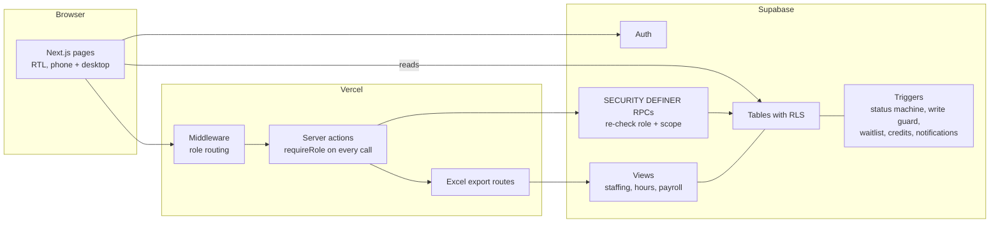
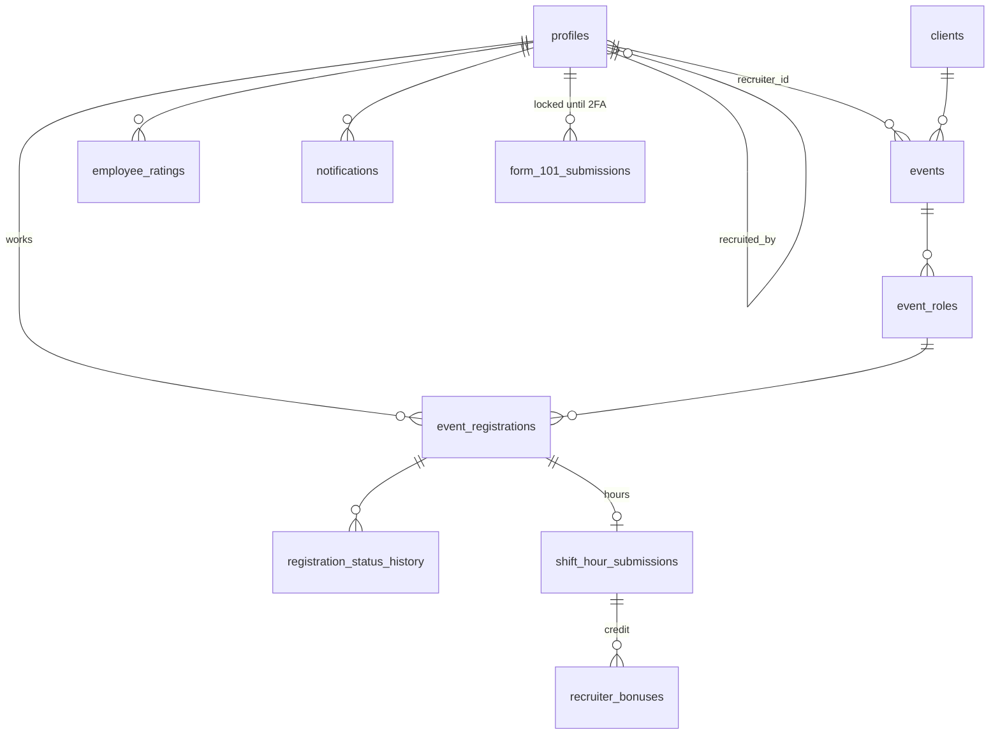

# everyJob CRM

Workforce management for shift-based staffing companies in Israel: recruitment, event staffing, waitlists,
attendance, hour approval, payroll reports and client billing, with four roles (Admin, Manager, Recruiter,
Employee). Hebrew-first and right-to-left; works on phone and desktop.

- **Rules for contributors and coding agents:** [AGENTS.md](AGENTS.md) (authoritative)
- **Product spec:** [docs/spec-full.md](docs/spec-full.md) · **Roadmap:** [docs/roadmap.md](docs/roadmap.md)
- **Due diligence:** [docs/due-diligence/](docs/due-diligence/)

## Stack

| Layer | Choice |
|---|---|
| App | Next.js 16 (App Router, server actions), React 19, TypeScript |
| Database, auth | Supabase: PostgreSQL 17, Row Level Security, SECURITY DEFINER RPCs, triggers |
| UI | Tailwind CSS v4 (logical properties for RTL), Framer Motion |
| Forms | Zod + react-hook-form (input/output split, AGENTS §5.3) |
| Exports | exceljs (payroll and billing `.xlsx`) |
| Hosting | Vercel (app), Supabase (database, auth, edge function) |
| CI | GitHub Actions: ESLint + `tsc --noEmit` |

## Local setup

Requirements: Node.js 20+, npm, a Supabase project (or access to the existing one).

```bash
npm ci
cp .env.example .env.local     # fill in the values, see the table below
npm run dev                    # http://localhost:3000
```

| Variable | Where | Purpose |
|---|---|---|
| `NEXT_PUBLIC_SUPABASE_URL`, `NEXT_PUBLIC_SUPABASE_ANON_KEY` | browser + server | Supabase client |
| `SUPABASE_SERVICE_ROLE_KEY` | server only | signup / profile API routes (`app/api/auth/*`) |
| `SIGNUP_RATE_LIMIT_SECRET` | server only | hashes national IDs for signup rate limiting |
| `NEXT_PUBLIC_SITE_URL` | browser + server | auth email links, Open Graph |
| `DEV_SKIP_EMAIL_VERIFICATION` | server, **dev only** | skips email verification; removed before launch |

## Scripts

| Command | What it does |
|---|---|
| `npm run dev` / `build` / `start` | Next.js |
| `npm run lint` · `npm run typecheck` | the CI gates |
| `npm run test:e2e` | Playwright smoke tests ([e2e/README.md](e2e/README.md)) |

SQL behaviour tests for the database rules live in `supabase/tests/` and run in the Supabase SQL Editor inside a
transaction that rolls back.

## Architecture



Three rules carry the design (details in AGENTS.md §5):

1. **Authorization lives in the database.** RLS policies and RPCs re-check the caller's role and scope; the UI and
   `auth-context.tsx` only decide what to show. Server actions also call `requireRole()` (`lib/auth/guards.ts`).
2. **Derived state lives in views.** Staffing status, hour totals and payroll are computed by views
   (`event_role_fill_counts`, `v_my_monthly_hours`, ...), never stored.
3. **Registrations change only through RPCs.** A trigger blocks direct writes to `event_registrations`; every
   transition (register, approve, waitlist, cancel, remove) is an RPC that records history.

## Data model (core tables)



| Table | Holds |
|---|---|
| `profiles` | every user: `role` (admin, manager, recruiter, employee), national ID, phone, birth date, city/region, role tags, approval status, rating |
| `clients` | client companies, contacts, per-role price list (`preferred_roles`, Admin-only) |
| `events`, `event_roles` | an event and its roles: headcount, times, worker base rate, client price (`bill_to_client`) |
| `event_registrations` | a worker on a role: `pending`, `approved`, `waitlisted`, `rejected`, `cancelled`, `removed` |
| `shift_hour_submissions` | hours reported by a Manager, approved or rejected by an Admin |
| `recruiter_bonuses` | recruitment-credit ledger, redeemed FIFO |
| `billing_cycles` | monthly billing close / reopen |
| `form_101_submissions`, `employee_documents` | tax and bank data; deny-all until Admin 2FA exists |

Roles and permissions: [AGENTS.md §6](AGENTS.md). Event status model and transitions: AGENTS.md §6.1.

## Repository layout

```
app/            routes: admin/, manager/ (manager + recruiter), employee/, api/auth/, public and legal pages
components/     UI by area (admin, manager, employee, events, shell, ui)
lib/            auth (permissions, guards), events (status model, DB error mapping), validations, supabase clients
supabase/       migrations/ (CLI history), pending/ (reviewed SQL not yet applied), tests/, live_snapshot/, functions/
e2e/            Playwright smoke tests
docs/           spec, roadmap, design notes, due diligence, sales
```

## Database workflow

The live database is the source of truth. New SQL is written to `supabase/pending/`, reviewed, applied, then saved
as a timestamped file in `supabase/migrations/` (AGENTS.md §5.6, §11). After a schema change regenerate types:

```bash
npx supabase gen types typescript --linked > types/supabase.ts
```

Migration history, the hand-applied migrations and how to build a fresh production database:
[docs/due-diligence/migrations-runbook.md](docs/due-diligence/migrations-runbook.md).

## Deployment

1. Vercel project connected to the GitHub repository; production builds from the default branch.
2. Environment variables from the table above in Vercel (Production and Preview).
3. Database changes are applied to Supabase first, then the app is deployed.

### Unverified-account cleanup

`supabase/functions/cleanup-unverified-users/` removes accounts whose email was never confirmed after 24 hours,
so they do not hold a national ID or email forever. It defaults to dry-run, checks every dependent table first and
masks national IDs in its logs. It is not scheduled yet (see the pre-launch list in the roadmap).

## Before production launch

Admin 2FA (then Form 101 and bank details), email verification with a verified domain, a separate production
Supabase project, backups and monitoring. The full list is "Pre-launch" and Stage 5 in
[docs/roadmap.md](docs/roadmap.md).
